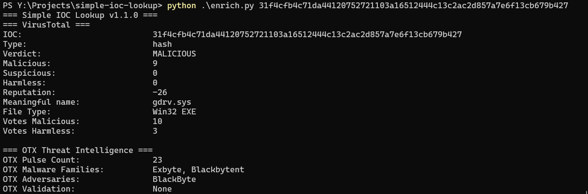
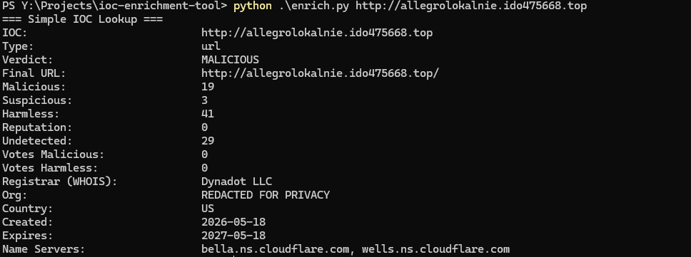
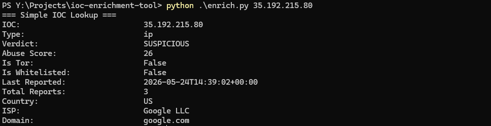
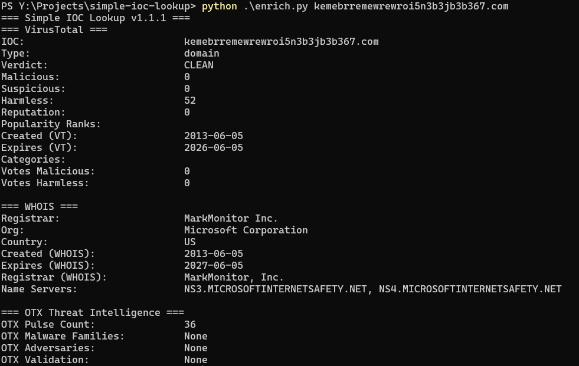

# Simple IOC Lookup

[](https://github.com/philipzangara/simple-ioc-lookup/actions/workflows/mypy.yml)

A Python-based IOC enrichment tool that performs automated triage of IP addresses, domains, URLs, and file hashes using multiple threat intelligence providers.

## Features

- Automatic IOC type detection (IP, domain, URL, hash)
- VirusTotal URL enrichment
- VirusTotal hash enrichment
- AbuseIPDB IP reputation analysis
- Domain enrichment
- WHOIS lookup for domain and URL IOCs
- AlienVault OTX enrichment
- JSON output support
- Automated static type checking with MyPy
- Continuous Integration with GitHub Actions

## Code Quality

This project follows modern software engineering practices:

-  Static type checking with MyPy
- Automated CI/CD using GitHub Actions
- Type validation on every push and pull request
- Unit testing with unittest
- Python 3.10 support

## Usage

### Windows

```bash
python enrich.py <ioc>
```

### Linux / macOS

```bash
python3 enrich.py <ioc>
```

### JSON Output

```bash
python enrich.py <ioc> --output json
```

### Save Output to File

```bash
python enrich.py <ioc> --output json > result.json
```

## Requirements

```bash
pip install -r requirements.txt
```

Tested with Python 3.10.11.

## API Keys

This tool uses the following free services:

- VirusTotal (free account required)
- AbuseIPDB (free account required)
- AlienVault OTX (free account recommended)

**Note:** VirusTotal's free tier is limited to four requests per minute. Allow approximately 15 seconds between lookups to avoid rate limiting.

Place API keys in a `.env` file:

```env
VT_API_KEY=your_key_here
ABUSEIPDB_API_KEY=your_key_here
OTX_API_KEY=your_key_here
```

If a key is missing, the corresponding enrichment source is automatically skipped.

## How It Works

1. Detects the IOC type automatically.
2. Selects the appropriate enrichment providers.
3. Performs threat intelligence lookups.
4. Collects and normalizes enrichment data.
5. Returns a verdict based on detections, reputation scores, and threat intelligence context.

| IOC Type | Sources |
|-----------|----------|
| URL | VirusTotal, WHOIS, OTX |
| IP | AbuseIPDB, OTX |
| Hash | VirusTotal, OTX |
| Domain | VirusTotal, WHOIS, OTX |

## MITRE ATT&CK Mapping

- T1566 – Phishing
- T1071 – Application Layer Protocol
- T1204 – User Execution
- T1190 – Exploit Public-Facing Application

## Sample Output

**Hash Lookup**



**URL Lookup**



**IP Lookup**



**Domain Lookup**



## Sample Data

Test IOCs are sourced from publicly available phishing and malware intelligence feeds.

## Version

1.1.0

## Author

Philip Zangara

## License

MIT

---

## Purpose

This project was developed as part of a personal cybersecurity portfolio to strengthen skills in threat intelligence enrichment, Python development, software engineering, and security tooling.
